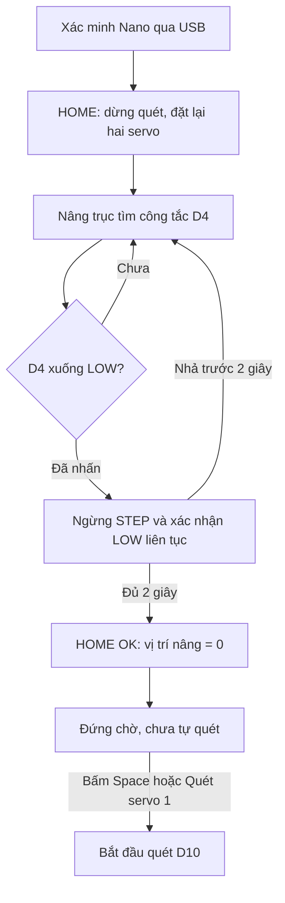

# OMNI SH90 · Sonar Nano

**Giao diện sonar tròn trên Windows và Raspberry Pi 5, kết nối Arduino Nano qua USB.**

Đọc khoảng cách cảm biến, vẽ điểm theo góc quét, điều khiển nâng/hạ và đưa cơ cấu về HOME. Các bản trong repo sử dụng **Range 7–18 cm**, mặc định **18 cm**.

[**Tải bản Windows**](./OMNI_SH90_NANO.zip?raw=true) · [**Tải bản Raspberry Pi 5**](./OMNI_SH90_NANO_RASPI5.zip?raw=true)

> **Bắt đầu nhanh:** tải đúng ZIP → giải nén toàn bộ → nạp firmware hệ thống vào Nano → mở ứng dụng → chờ **CONNECT / HOME OK** → bấm **Quét servo 1** hoặc **Space**.
>
> Sau khi kết nối được xác minh, chương trình **tự chạy HOME**. Chuẩn bị cơ cấu ở trạng thái có thể di chuyển trước khi mở ứng dụng.

## Mục lục

- [Chọn đúng tệp ZIP](#chon-ban)
- [Chuẩn bị và đấu dây](#dau-day)
- [Nạp chương trình vào Nano](#nap-nano)
- [Chạy trên Windows](#windows)
- [Chạy trên Raspberry Pi 5](#raspberry-pi)
- [Kết nối và HOME hoạt động thế nào?](#home)
- [Các phím và nút điều khiển](#dieu-khien)
- [Đọc khoảng cách và chấm sonar](#doc-so-do)
- [Đọc log Terminal](#terminal)
- [Xử lý lỗi thường gặp](#xu-ly-loi)
- [Test riêng cảm biến UART](#test-uart)
- [Tệp quan trọng và giới hạn](#tep-va-gioi-han)

<a id="chon-ban"></a>
## 1. Chọn đúng tệp ZIP

| Bạn sử dụng | Tệp cần tải | Thư mục sau giải nén | Cách chạy chính |
|---|---|---|---|
| Máy tính Windows | [**OMNI_SH90_NANO.zip**](./OMNI_SH90_NANO.zip?raw=true) | `sonar_simulator_laptop` | Mở `DO_CAM_BIEN_WINDOWS.bat` |
| Raspberry Pi 5 | [**OMNI_SH90_NANO_RASPI5.zip**](./OMNI_SH90_NANO_RASPI5.zip?raw=true) | `sonar_raspi5` | `python3 main.py` |

Nội dung hiện có: **Windows V16**, **Raspberry Pi 5 V18**. Cả hai cùng dùng chân Nano, phép chiếu và thang cm bên dưới. Bản Pi có thêm trình kiểm tra/cài thư viện và các tệp thiết lập desktop.

**Không cần tải cả hai ZIP.** Nút **Code → Download ZIP** của GitHub tải toàn bộ repo; nếu dùng cách đó, vẫn cần giải nén tiếp tệp ZIP ứng dụng bên trong.

<a id="dau-day"></a>
## 2. Chuẩn bị và đấu dây

### Phần mềm và thiết bị

| Thành phần | Yêu cầu |
|---|---|
| Bộ điều khiển | Arduino Nano/RF-Nano dùng ATmega328P, tương thích firmware trong gói |
| Kết nối với máy chạy giao diện | Cáp USB **có truyền dữ liệu** |
| Máy tính | Python **3.9 trở lên** và trình duyệt |
| Raspberry Pi 5 | Raspberry Pi OS **64-bit có Desktop**, Python và Chromium |
| Cảm biến trong cấu hình này | Sonar UART SEN0599; nguồn và môi trường làm việc đúng thông số của model |
| Cơ cấu | Driver động cơ bước nhận STEP/DIR, công tắc HOME và hai servo phù hợp dải xung đã cấu hình |

Python chỉ cần thư viện ngoài `pyserial` theo `requirements.txt`. **Không cần Node.js hoặc npm để chạy ứng dụng.** Arduino IDE dùng để nạp `.ino`, không phải để chạy giao diện.

### Chân nối hiện tại — áp dụng cho cả hai ZIP

| Dây/thiết bị | Chân Nano | Ý nghĩa |
|---|---|---|
| **Trắng TX cảm biến** | **D3** | Nano RX nhận dữ liệu cảm biến |
| **Vàng RX cảm biến** | **D2** | Nano TX gửi lệnh đo |
| Đen GND cảm biến | GND | Nối mass chung |
| Đỏ VCC cảm biến | Nguồn phù hợp model | SEN0599 có dải nguồn 5–24 V theo tài liệu hãng |
| Công tắc HOME, tiếp điểm **NO** | D4 ↔ GND | `INPUT_PULLUP`: thả = HIGH, nhấn = LOW |
| STEP / PUL của driver | D5 | Xung nâng/hạ |
| DIR của driver | D6 | HIGH = đi lên, LOW = đi xuống theo cấu hình hiện tại |
| Servo nghiêng | D9 | −30°…+30° |
| Servo quét | D10 | 500…2500 µs |

**TX phải nối sang RX:** trong cấu hình này, trắng vào **D3**, vàng vào **D2**. Khai báo firmware là `SONAR_RX = 3, SONAR_TX = 2`.

Nguồn servo/motor phải phù hợp thiết bị và nối GND chung với Nano; không đưa điện áp nguồn motor vào chân tín hiệu. Pi nối Nano bằng **USB**; bảng trên là chân **Nano**, không phải chân GPIO của Pi.

SEN0599 là cảm biến **đo dưới nước**. Đặt đầu dò trong nước và hướng mặt đo vào vật; việc thử trong không khí có thể trả giá trị 0. Nếu dùng cảm biến khác, kiểm tra lại pinout, nguồn và giao thức của chính model đó.

<a id="nap-nano"></a>
## 3. Nạp chương trình vào Nano

Hai ZIP đều chứa firmware hệ thống tại:

```text
firmware/RF_Nano_Omni_Controller/RF_Nano_Omni_Controller.ino
```

1. **Đóng ứng dụng Python và Serial Monitor** để giải phóng cổng USB.
2. Mở file `.ino` trên bằng Arduino IDE.
3. Chọn đúng board Nano, cổng và tùy chọn processor/bootloader tương ứng bo đang dùng.
4. Upload, sau đó đóng Serial Monitor trước khi mở Python.

Firmware hệ thống trong hai ZIP có cùng cấu hình điều khiển; đổi từ Windows sang Pi không yêu cầu nạp lại nếu Nano đã có đúng firmware này. **Nếu Nano đang chạy mã test UART, phải nạp lại firmware hệ thống.**

> `NANO_SONAR_UART_TEST.ino` chỉ dành cho chẩn đoán cảm biến. Nó không xuất giao thức `OMNI_NANO` để ứng dụng điều khiển thiết bị.

<a id="windows"></a>
## 4. Chạy trên Windows

### Lần đầu

1. Cài **Python 3.9+**; bật tùy chọn **Add Python to PATH** nếu trình cài cung cấp.
2. Giải nén `OMNI_SH90_NANO.zip` vào thư mục có quyền ghi.
3. Vào thư mục `sonar_simulator_laptop` và mở **`DO_CAM_BIEN_WINDOWS.bat`**.
4. Khi thiếu `pyserial`, `main.py` sẽ tạo `.venv` và cài thư viện; lần cài cần Internet.
5. Giữ cửa sổ Terminal mở để xem khoảng cách, kết nối và tiến trình HOME.

Có thể dùng `START_WINDOWS.bat` hoặc mở Terminal ngay trong thư mục rồi chạy:

```powershell
python main.py
```

Nếu máy dùng Python Launcher:

```powershell
py -3 main.py
```

Toàn màn hình với Chromium/Chrome/Edge nếu có trình duyệt tương thích:

```powershell
python main.py --kiosk
```

### Mỗi lần sử dụng

Cắm Nano → mở `DO_CAM_BIEN_WINDOWS.bat` → chờ **CONNECT / HOME OK** → bấm quét khi sẵn sàng. Cổng trên Windows thường có dạng `COM3`, `COM5`…; ứng dụng tự dò và xác minh Nano.

<a id="raspberry-pi"></a>
## 5. Chạy trên Raspberry Pi 5

Giải nén `OMNI_SH90_NANO_RASPI5.zip`, mở Terminal trong thư mục **`sonar_raspi5`** có `main.py`.

### Cách A — chạy trực tiếp bằng main.py

```bash
python3 main.py
```

Toàn màn hình:

```bash
python3 main.py --kiosk
```

Bản Pi tự kiểm tra thư viện trước khi khởi động server:

| Trạng thái | Chương trình xử lý |
|---|---|
| Python hiện tại đã đủ thư viện | Chạy tiếp, không tải lại |
| Đã có `.venv` hợp lệ | Dùng lại môi trường của dự án |
| Thiếu `pyserial` hoặc module `serial` không đúng API | Tạo/sửa môi trường dự án, cài từ `requirements.txt`, kiểm tra lại rồi chạy tiếp |
| Thiếu hỗ trợ tạo venv của hệ điều hành | Báo lệnh `apt` cần chạy một lần |
| Không có Internet khi cần cài | Báo lỗi; chạy lại sau khi khôi phục kết nối |

Nếu được báo thiếu hỗ trợ venv:

```bash
sudo apt install python3-venv python3-pip
python3 main.py
```

Để **chỉ kiểm tra/cài thư viện**, chưa kết nối Nano:

```bash
python3 CAI_THU_VIEN.py
```

Trình tự động chỉ cài các phụ thuộc được khai báo khi cần; không tự nâng mọi gói lên phiên bản mới nhất. Nó không tải bù `server.py`, `hardware_bridge.py` hoặc các file mã nguồn bị thiếu — hãy giải nén **toàn bộ ZIP**.

### Cách B — thiết lập Pi lần đầu và tạo shortcut

```bash
bash SETUP_RASPI5.sh
```

Script cài Python, hỗ trợ venv/pip, pyserial và Chromium bằng `apt`, thêm tài khoản hiện tại vào nhóm `dialout` nếu thiếu, đồng thời tạo shortcut **OMNI Sonar Nano**.

**Chạy script bằng tài khoản desktop, không thêm `sudo` trước cả lệnh.** Script sẽ gọi `sudo` cho các thao tác cần quyền hệ thống. Nếu vừa được thêm vào `dialout`, đăng xuất/đăng nhập lại hoặc khởi động lại Pi.

Sau đó:

```bash
bash RUN_RASPI5.sh
```

Hoặc mở shortcut trong menu/desktop. Nếu desktop yêu cầu, chọn **Allow Launching**. Khi chuyển thư mục ứng dụng sang vị trí khác, tạo lại shortcut bằng:

```bash
python3 pi_desktop.py
```

Tệp chạy mở kiosk và giữ Terminal. **Không chạy `main.py` hoặc Chromium bằng sudo.** Không có bước tự sửa autostart hay tự bật ứng dụng sau khi khởi động Pi trong gói hiện tại.

<details>
<summary><strong>Chỉ chạy server qua SSH / chỉ định cổng</strong></summary>

```bash
python3 main.py --no-browser
```

Server lắng nghe tại `127.0.0.1`, nên giao diện được mở trên chính Pi; không truy cập trực tiếp bằng IP LAN với cấu hình hiện tại.

Ứng dụng tự dò cổng USB, thường là `/dev/ttyUSB0` hoặc `/dev/ttyACM0`. Nếu cần chọn cổng rõ ràng, dùng tên đang xuất hiện trên máy:

```bash
python3 main.py --serial-port /dev/ttyUSB0
```

Đổi cổng HTTP nếu 8765 đang được dùng bởi chương trình khác:

```bash
python3 main.py --port 8766
```

</details>

<a id="home"></a>
## 6. Kết nối và HOME hoạt động thế nào?

Địa chỉ giao diện mặc định trên máy đang chạy Python: **<http://127.0.0.1:8765>**.

Ứng dụng tự tìm USB và chỉ gửi HOME sau khi xác minh đúng firmware **`OMNI_NANO`, protocol 3**. Bấm **CONNECT** trên giao diện để xem trạng thái, chọn cổng hoặc ngắt kết nối thủ công.



| Mốc khi HOME | Giá trị |
|---|---|
| D10 | **1400 µs**, kim hướng **+OY** |
| D9 | **900 µs = 0°**, phép chiếu ở **tâm O** |
| Công tắc D4 | LOW liên tục **2 giây** mới được xác nhận |
| Sau HOME | Motor nghỉ, không tự quét |

Nút **HOME** thực hiện lại quy trình này, xóa vết đo cũ và đưa con trỏ về tâm. Khi đang HOME, lệnh đổi góc bị chặn; **DỪNG** vẫn hủy được HOME. Các giới hạn tìm HOME trong firmware là 40.000 xung / 180 giây, không phải cơ chế bảo vệ toàn bộ hành trình cơ khí.

<a id="dieu-khien"></a>
## 7. Các phím và nút điều khiển

Bấm vào cửa sổ giao diện để nhận phím. Khi đang nhập ô văn bản hoặc mở một số hộp thoại, phím điều khiển thiết bị có thể không được xử lý.

### Điều khiển thiết bị

| Phím/nút | Chức năng |
|---|---|
| **Giữ W / S** | Nâng / hạ; **thả để dừng motor** |
| Giữ I / L | Nâng / hạ tương tự W / S |
| **Space** | Bắt đầu, dừng hoặc tiếp tục quét D10 |
| **HOME** trên màn hình | Đặt lại trục nâng và hai servo về mốc |
| **−10° / +10°** | Đổi D9 từng 10°, giới hạn −30°…+30° |
| **DỪNG** trên màn hình | Dừng motor và quét, kể cả đang HOME |
| **Q / E** | Giảm / tăng Range từng 1 cm, từ 7 đến 18 cm |
| J / K | Giảm / tăng độ rõ hiển thị |
| P | Bật/tắt TX trên giao diện; tắt TX cũng dừng quét; bật TX không tự bắt đầu quay |
| F3 | Bật/tắt POWER; tắt gửi lệnh dừng xuống Nano |

Hạ xuống mặc định **không có giới hạn tổng xung phần mềm**; người điều khiển cần thả phím/bấm DỪNG theo hành trình thực. Mất focus ngừng nâng/hạ; mất liên lạc USB có watchdog dừng motor và quét.

### Quan sát và thao tác giao diện

| Phím/nút | Chức năng |
|---|---|
| Nhấp gần chấm đo | Xem d, X/Y, bán kính và đường kính vòng quét của mẫu |
| Mũi tên | Di chuyển con trỏ đo |
| Enter / Backspace | Đặt / xóa dấu đo |
| F / M | Toàn màn hình / ẩn hoặc hiện menu |
| F2 / H | Bảng nút / hướng dẫn |
| N | Đổi Bow Up / North Up |
| Z / X | Zoom / Off Centre |
| C | Chụp ảnh sonar |
| F6 / F7 | Xem ảnh / chụp hoặc ghi chuỗi ảnh theo chế độ đã chọn |
| F4 | Tắt âm, xác nhận cảnh báo giao diện |
| Y / 0 / G | Symbol tròn / tàu / ngư cụ |
| V / O | Menu View / Object |
| 1…4 | Chọn tab Horizontal / Display / Setup / Objects |
| 5…8 | Chọn chế độ trình bày gốc |
| R | Mở hộp thoại khởi động lại phiên |
| T | Mở trình sửa kịch bản demo; không tạo dữ liệu UART thật |

Giữ Shift khi chỉnh thông số giao diện để đổi nhanh. **A/D đã bỏ; U/B/Esc/Home không gửi lệnh điều khiển thiết bị.** Dùng nút HOME và DỪNG sẵn trên màn hình.

**Kết thúc sử dụng:** bấm DỪNG, sau đó Ctrl+C ở Terminal để đóng server. Với kiosk trên Pi, Alt+F4 chỉ đóng cửa sổ trình duyệt; server có thể vẫn chạy trong Terminal.

<a id="doc-so-do"></a>
## 8. Đọc khoảng cách và chấm sonar

### d, Range và Rxy khác nhau thế nào?

| Chỉ số | Ý nghĩa | Ví dụ |
|---|---|---|
| **d** | Khoảng cách đầu dò đến vật **theo tia đo** | `d = 16,5 cm` |
| **Range** | Khoảng cách nghiêng tối đa được hiển thị | Chọn `18 cm` để chứa mẫu d = 16,5 cm |
| **Rxy** | Bán kính chiếu ngang tối đa của vòng tròn | `Range = 18 cm` → `Rxy = 9 cm` |
| **X / Y** | Tọa độ chiếu ngang của vật theo góc lúc lấy mẫu | Đơn vị cm |
| **r** | Khoảng cách từ chấm đến tâm O | `r = d × |sin(D9)|` |
| **Ø quét** | Đường kính vòng quét hình học `2 × r` | Không phải kích thước thật của vật |

Các mức Range là **7, 8, 9, 10, 11, 12, 13, 14, 15, 16, 17, 18 cm**. Mặc định 18 cm. Do giới hạn nghiêng ±30°, thang vòng dùng **Rxy = Range/2**; cách chia này không thay đổi khi chỉnh D9 xuống 10°.

Ví dụ cùng một vật ở **d = 16,5 cm**, chọn **Range = 18 cm**:

| D9 | Bán kính r | Chấm nằm ở đâu? |
|---:|---:|---|
| 0° | 0 cm | Tâm O |
| +10° | Khoảng 2,87 cm | Khoảng 31,8% bán kính vòng |
| +30° | 8,25 cm | Khoảng 91,7% bán kính vòng |

Góc âm đưa điểm chiếu về phía đối diện so với góc dương cùng độ lớn. D10 quyết định phương vị của chấm. X/Y được tính từ góc đi kèm **chính mẫu đo**, không ghép khoảng cách cũ với góc servo hiện tại.

### Thử nhanh để thấy chấm

1. Chờ **HOME OK**.
2. Chọn **Range = 18 cm**.
3. Bấm **+10°**; nếu cần +30°, bấm +10° ba lần, phù hợp hướng cơ khí đang thử.
4. Kiểm tra **POWER ON** và **TX không OFF**; dùng F3/P khi cần.
5. Đặt vật trong vùng đo của đầu dò và trong Range đang chọn. Bấm **Quét servo 1** hoặc Space nếu muốn quét.
6. Quan sát số d trong dòng đo/Terminal và nhấp gần chấm để đọc tọa độ.

Sau HOME, D9 = 0° nên chấm hợp lệ có thể nằm ngay tâm. Nếu **d lớn hơn Range**, Terminal vẫn báo số nhưng chấm không được vẽ. Vật gần thường đậm hơn; các vết lưu mờ dần trong khoảng 20 giây.

Không có mẫu đo hợp lệ thì không tạo chấm vật thật. Mở riêng `index.html` hoặc `SONAR_TRAINER.html` qua `file://` chỉ chạy demo; dùng `main.py` để kết nối Nano.

<details>
<summary><strong>Mốc hiệu chỉnh và công thức chiếu</strong></summary>

| D9 | Góc lệnh |
|---:|---:|
| 500 µs | −30° |
| 767 µs | −10° |
| 900 µs | 0° |
| 1000 µs | +10° |
| 1200 µs | +30° |

D10 = 1400 µs trùng +OY. Mã dùng dải 500–2500 µs tương ứng 360° phương vị; tăng xung từ mốc +OY đưa điểm về phía X âm khi D9 dương.

Với góc D9 là θ và góc phương vị α:

```text
α = (xung D10 − 1400) × 0,18°
ρ = d × sin(θ)
X = −ρ × sin(α)
Y =  ρ × cos(α)
r = |ρ|
Ø quét = 2r
```

Đây là mô hình theo mốc hiệu chỉnh của dự án. Nano báo góc lệnh/xung, không đọc encoder trên trục. Servo quay liên tục theo tốc độ không thể dùng công thức xung → góc định vị này nếu chưa có phản hồi góc phù hợp.

</details>

<a id="terminal"></a>
## 9. Đọc log Terminal

**Không cần bấm quét để xem số cm sau HOME.** Log vẫn hoạt động khi servo đang dừng hoặc TX hiển thị đang OFF.

Ví dụ định dạng khi có mẫu hợp lệ — số dưới đây chỉ để minh họa:

```text
SONAR d=16.5 cm | D10=1400 us | D9=30 deg | X=0.0 Y=8.2 cm | r=8.2 cm | scan_diameter=16.5 cm
```

| Dòng log | Cách hiểu |
|---|---|
| `USB ... DA MO` | Đã mở cổng; đang xác minh, chưa đồng nghĩa có dữ liệu cảm biến |
| `D4=HIGH / THA ... DANG TIM HOME` | Trục đang tìm công tắc |
| `D4=LOW / NHAN ... CHO XAC NHAN` | Đang xác nhận công tắc LOW liên tục |
| `HOME OK ... motor=idle` | HOME đã được xác nhận; motor nghỉ |
| `SONAR DANG HOME` | Đang chờ HOME xong rồi đo |
| `SONAR d=... cm` | Có mẫu khoảng cách hợp lệ; số lấy từ cảm biến |
| `SONAR CHUA CO MAU DO HOP LE` | USB Nano hoạt động nhưng chưa có mẫu khoảng cách hợp lệ; chưa đủ để kết luận không có vật |
| `USB ERROR` | Có lỗi/mất kết nối USB; xem nội dung theo sau |

Log khoảng cách được giới hạn tối đa khoảng **4 dòng/giây**; trạng thái chờ cảm biến được nhắc khoảng **2 giây/lần**. Điều đó không có nghĩa cảm biến được xác nhận hỏng.

<a id="xu-ly-loi"></a>
## 10. Xử lý lỗi thường gặp

| Hiện tượng | Kiểm tra và cách xử lý |
|---|---|
| Không có dòng đo hoặc hiện DEMO | Đóng file HTML mở trực tiếp; chạy `main.py` hoặc tệp khởi động của đúng bản |
| Không tìm được Nano | Kiểm tra cáp USB dữ liệu, cổng, driver USB của bo trên Windows; bấm CONNECT xem danh sách cổng |
| Mở cổng thất bại / cổng bận | Đóng Serial Monitor, Python cũ và ứng dụng khác đang giữ cổng; chỉ chạy một phiên |
| Pi báo `Permission denied` | Chạy SETUP để thêm `dialout`, rồi đăng xuất/đăng nhập lại; không chạy trình duyệt bằng sudo |
| Chưa xác minh `OMNI_NANO v3` | Nạp đúng firmware hệ thống, đúng board/cổng; đóng Serial Monitor; mã test UART không thay thế được firmware hệ thống |
| Thấy d nhưng không thấy chấm | Kiểm tra POWER/TX, `d ≤ Range`, D9 = 0° có đưa điểm về tâm hay không; chờ vết mới sau khi đổi góc |
| Chấm bị giữ ở tâm | D9 = 0° có r = 0; thử đổi ±10° sau khi HOME xong |
| HOME chưa kết thúc | Xem D4 có đổi HIGH → LOW khi nhấn hay không; kiểm tra tiếp điểm NO–GND và trạng thái LOW đủ 2 giây |
| `unexpected_home_switch_during_down` | Firmware đã thấy D4 bị nhấn ổn định khi đang hạ; kiểm tra công tắc, đấu dây và cơ cấu |
| `home_switch_stuck_low` | Công tắc vẫn LOW sau khi rời HOME; kiểm tra công tắc có nhả đúng không |
| `home_timeout_or_pulse_cutoff` | Đã tới giới hạn tìm HOME; kiểm tra chiều chạy, vị trí và dây công tắc trước khi HOME lại |
| Thiếu pyserial / lỗi module `serial` | Bản Pi: chạy `python3 CAI_THU_VIEN.py`. Bản Windows: dùng các lệnh sửa thư viện trong phần bên dưới |
| Pi báo thiếu `venv` | Cài `python3-venv python3-pip`, rồi chạy lại main.py |
| Lỗi cổng HTTP 8765 | Đóng server cũ hoặc dùng `--port 8766`; mở đúng địa chỉ được in ở Terminal |
| Di chuyển thư mục rồi shortcut không chạy | Trên Pi, chạy lại `python3 pi_desktop.py` trong thư mục mới |

<details>
<summary><strong>Sửa thư viện Windows thủ công khi cần</strong></summary>

Chạy trong thư mục `sonar_simulator_laptop`:

```powershell
py -3 -m venv .venv
.venv\Scripts\python.exe -m pip install -r requirements.txt
.venv\Scripts\python.exe main.py
```

Tệp `main.py` của Windows V16 tự cài khi chưa tìm thấy module serial; bộ kiểm tra API/reuse venv của bản Pi V18 đầy đủ hơn. Nếu vô tình có tệp riêng tên `serial.py` trong thư mục dự án, kiểm tra xung đột tên trước khi cài lại.

</details>

<a id="test-uart"></a>
## 11. Test riêng cảm biến UART

Dùng khi Terminal liên tục báo chưa có mẫu hợp lệ. Cả hai ZIP chứa:

```text
firmware/NANO_SONAR_UART_TEST/NANO_SONAR_UART_TEST.ino
```

1. **Đóng Python** và Serial Monitor cũ.
2. Nạp mã test vào Nano bằng Arduino IDE.
3. Mở Serial Monitor ở **115200 baud**.
4. Giữ đầu dò trong môi trường đo đúng model; hướng vật vào mặt đầu dò.
5. Đọc hoặc lưu 3–5 nhóm `TEST / RAW_HEX / STATE`.

Ví dụ khung hợp lệ, minh họa khoảng cách 20 cm:

```text
TEST #1 | TX=55 | RX_BYTES=4
RAW_HEX: FF 00 C8 C7
FRAME_OK | mm=200 | d=20.0 cm
STATE=VALID_DISTANCE
```

| Kết quả test | Ý nghĩa |
|---|---|
| `RX_BYTES=0` / `STATE=NO_RX` | Không nhận được byte trong 200 ms; kiểm tra nguồn/GND, trắng TX → D3, vàng RX → D2, đúng model/giao thức |
| `RAW_HEX: FF 00 00 FF` / `ZERO_MM` | Có phản hồi đúng checksum nhưng khoảng cách bằng 0; chưa phải phép đo để vẽ vật |
| `VALID_DISTANCE` | Có khoảng cách hợp lệ; thử vật gần/xa và xem d thay đổi |
| `BAD_CHECKSUM` | Có byte nhưng khung lỗi; kiểm tra tín hiệu UART, nguồn, baud và model |
| `INCOMPLETE_FRAME` | Có header nhưng chưa đủ khung 4 byte |
| `NO_FF_HEADER` | Có byte không khớp đầu khung đang chờ |
| `OUT_OF_RANGE` | Khung đúng checksum nhưng ngoài dải 50–6000 mm được cấu hình |

**Sau test:** đóng Serial Monitor → nạp lại `RF_Nano_Omni_Controller.ino` → mở lại ứng dụng Python. Không chạy giao diện với mã test UART còn ở trên Nano.

<a id="tep-va-gioi-han"></a>
## 12. Tệp quan trọng và giới hạn

| Tệp/thư mục bên trong ZIP | Vai trò |
|---|---|
| `main.py` | Điểm chạy ứng dụng |
| `server.py` | Server local cho giao diện và API |
| `hardware_bridge.py` | Dò USB, xác minh Nano, gửi lệnh và nhận mẫu đo |
| `requirements.txt` | Danh sách thư viện Python |
| `web/` | Giao diện, vẽ sonar và phép chiếu tọa độ |
| `firmware/RF_Nano_Omni_Controller/` | Firmware điều khiển đầy đủ |
| `firmware/NANO_SONAR_UART_TEST/` | Test cảm biến UART riêng |
| `DO_CAM_BIEN_WINDOWS.bat` | Mở ứng dụng/Terminal trên Windows |
| `SETUP_RASPI5.sh`, `RUN_RASPI5.sh` | Cài đặt và chạy kiosk trên Pi |
| `dependency_setup.py`, `CAI_THU_VIEN.py` | Kiểm tra/cài thư viện, có trong bản Pi |
| `pi_desktop.py` | Tạo shortcut trên Pi |
| `startup_error.log` | File lỗi được tạo khi main.py không khởi động được |
| `PHIM_CHUC_NANG.md`, `docs/` | Tài liệu bổ sung trong gói |

- **Range 7–18 cm là giới hạn hiển thị đang chọn**, không phải toàn bộ khả năng đo của cảm biến. Firmware nhận khung khoảng cách hợp lệ trong 50–6000 mm.
- Cảm biến đo khoảng cách, không xác định đó là bàn tay/cá/đá hoặc suy ra kích thước vật chỉ từ một điểm.
- Tọa độ phụ thuộc các mốc servo thực tế. Dữ liệu góc đang là góc lệnh; cần hiệu chuẩn cơ khí nếu dùng như hệ đo chính xác.
- Các mục tần số, beam và một số bộ lọc của giao diện gốc phục vụ mô phỏng/hiển thị, không lập trình lại cảm biến thật.
- Firmware dùng SoftwareSerial 115200 và thư viện Servo trên Nano; độ tin cậy thu UART và độ mượt cơ khí cần kiểm tra trên bộ thật.
- Có các bộ kiểm tra phần mềm trong `tests/`; kết quả mô phỏng không thay thế kiểm thử AVR, Nano và Pi 5 thực tế. Không cần chạy các bộ test để sử dụng ứng dụng.

## Tài liệu đối chiếu

- [Python — tải bộ cài](https://www.python.org/downloads/)
- [Arduino IDE](https://www.arduino.cc/en/software)
- [SEN0599 — thông số và màu dây](https://wiki.dfrobot.com/sen0599)
- [SEN0599 — giao thức UART](https://wiki.dfrobot.com/sen0599/docs/18113)
- [SEN0599 — ví dụ Arduino và môi trường đo](https://wiki.dfrobot.com/sen0599/docs/18114)
- [Raspberry Pi OS — Python và môi trường ảo](https://www.raspberrypi.com/documentation/computers/os.html)
- [Arduino — quyền truy cập cổng trên Linux](https://support.arduino.cc/hc/en-us/articles/360016495679-Fix-port-access-on-Linux)
